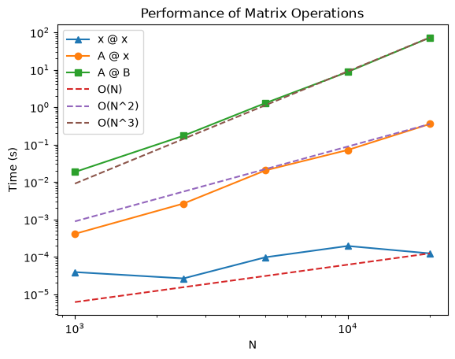
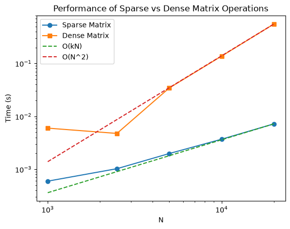
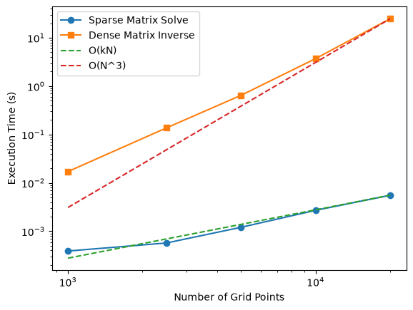
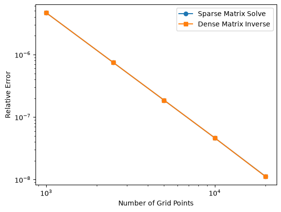
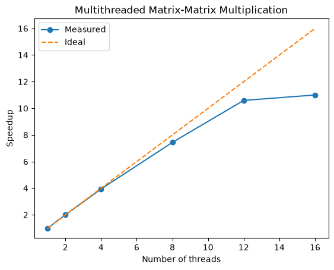
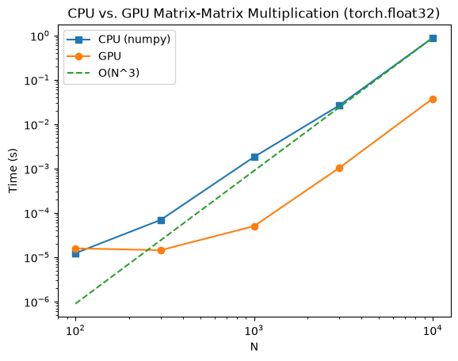
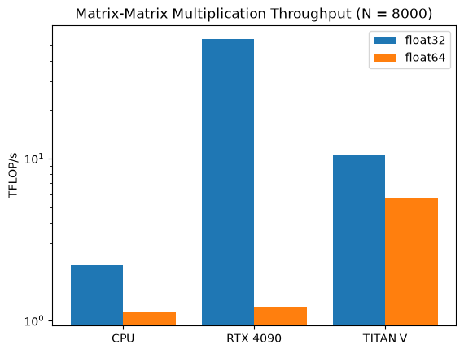

Lesson 3: Performance in Python
===============================

In this workshop, we will learn about the basics of performance in Python, especially for numerical methods.

Please refer to ``performance.ipynb`` in ``practicum/workshop_3`` for the interactive notebook.

.. note::

   The timings and plots on this page were measured on one workstation (Intel Xeon w5-2455X with 12 cores / 24 threads, one NVIDIA RTX 4090 and two NVIDIA TITAN V GPUs). Your numbers will be different, but the trends should be the same.

Performance of NumPy
--------------------

We first compare the efficiency of ``numpy`` vs. a ``python`` loop for a matrix-vector multiplication with :math:`N = 1000`:

.. code-block:: python

   for i in range(N):
       for j in range(N):
           y[i] += A[i, j] * x[j]      # 1.22 s

   y = np.dot(A, x)                    # 0.00037 s

``numpy`` is more than 3000 times faster!

   - In ``Python``, loops are actually *very* slow. 
   - ``Python`` is an interpreted language that reads line by line and spends a lot of time resolving the data types, variable names, etc.
   - In a compiled language like ``fortran`` or ``C++``, your code is translated and optimized to machine instructions before execution, so it runs much faster.
   - Luckily, most operations you will deal with in this class can be done with the ``numpy`` package. 
   - ``numpy`` calls the most efficient and commonly used libraries like ``OpenBLAS`` or ``Intel MKL`` for such calculations. These libraries have been developed over decades, are optimized at the machine level, and use all of your CPU's processing power.

To see the difference on your computer, open your ``Task Manager`` (Windows) or ``Activity Monitor`` (Mac) and run the following two cells:

.. code-block:: python

   N = 2000
   A = np.random.rand(N, N)
   x = np.random.rand(N)
   y = np.zeros((N, 1))

   for i in range(N):
       for j in range(N):
           y[i] += A[i, j] * x[j]

.. code-block:: python

   N = 20000
   A = np.random.rand(N, N)
   x = np.random.rand(N)
   y = np.dot(A, x)

You should see that the cell with ``numpy`` uses a much higher CPU %. If you have multiple processors on your computer, you will see that all of them are being used by ``numpy``.

Vectorization
-------------

Most of the operations you use in this class can be done with ``numpy`` functions. You should almost always be able to use ``numpy`` to replace for-loops, which is referred to as **vectorization**.

Here is a very practical example, where we want to set the entry :math:`out[i] = 1` if :math:`keys[i] < 0.5`, and :math:`out[i] = 2\, vals[i]` if :math:`keys[i] > 0.5`, for :math:`N = 10000`:

.. code-block:: python

   for i in range(N):
       for j in range(N):
           if keys[i, j] < 0.5:
               out[i, j] = 1
           else:
               out[i, j] = vals[i, j] * 2           # 23.7 s

   out[keys < 0.5] = 1                              # numpy's boolean indexing selects elements
   out[keys > 0.5] = vals[keys > 0.5] * 2           # of an array based on a condition: 1.64 s

Simple ``numpy`` operations are often easier to write and read overall, so you should get familiar with using the simpler ones.

.. tip::

   If more complex operations feel easier to code with for-loops, feel free to start with a for-loop. AI agents are really good at vectorizing an existing for-loop.

Computational Time Complexity
-----------------------------

As discussed in class, the time it takes to compute an operation scales with the number of elements. We demonstrate this most basic operations: 
   - vector-vector dot product
   - matrix-vector multiplication
   - matrix-matrix multiplication

   Run time of 5 repetitions of each product for :math:`N` from :math:`10^3` to :math:`2 \times 10^4`.

As the number of elements :math:`N` becomes very large, we should observe the following scaling of execution time:

.. list-table::
   :header-rows: 1

   * - Algorithm
     - Math
     - Scaling
   * - Dot Product
     - :math:`\mathbf x \cdot \mathbf x`
     - :math:`O(N)`
   * - Matrix-Vector Multiplication
     - :math:`\mathbf A \cdot \mathbf x`
     - :math:`O(N^2)`
   * - Matrix-Matrix Multiplication
     - :math:`\mathbf A \cdot \mathbf B`
     - :math:`O(N^3)`

The time complexity is determined from the number of mathematical operations in a given algorithm. For example, the dot product of :math:`\mathbf x \in \mathbb R^N`

.. math::

   \mathbf x \cdot \mathbf x = \sum_{i=1}^N x_i x_i

It has :math:`N` multiplications and :math:`N-1` additions, leading to :math:`2N-1` total operations. As :math:`N \rightarrow \infty`, what really matters is the power of :math:`N`, so we say that the dot product is an :math:`O(N)` operation.

.. note::

   The complexity does **not** depend on the programming language, optimization, etc. 

Here are some other famous algorithms and their time complexity:

.. list-table::
   :header-rows: 1

   * - Algorithm
     - Math
     - Scaling
   * - Scalar-Vector Multiplication
     - :math:`a\mathbf x`
     - :math:`O(N)`
   * - Fast Fourier Transform
     - :math:`\mathrm{FFT}(\mathbf x)`
     - :math:`O(N \ln N)`
   * - Quick Sort
     - :math:`\mathrm{Sort}(\mathbf x)`
     - :math:`O(N \ln N)`
   * - Matrix Inverse
     - :math:`\mathbf A^{-1}`
     - :math:`O(N^3)`
   * - LU Factorization
     - :math:`\mathbf A = \mathbf L \mathbf U`
     - :math:`O(N^3)`

.. admonition:: Question

   What is the time complexity of a composite operation, like :math:`\mathbf A \cdot \mathbf B \cdot \mathbf x`?

.. admonition:: Exercise

   In HW1 you implemented a Gaussian elimination solver for linear systems. Paste your solution into the notebook and benchmark its performance as a function of the vector size :math:`N`.

   Ask your AI agent of choice to vectorize the algorithm. How much better does it perform?

Faster! - Exploiting Sparsity
-----------------------------

The time scalings given above are for the *worst* case scenario, i.e. the most general matrices. In our class, and in numerical methods in general, many matrices are **sparse**, meaning that they contain many zeros!

For example, the center-point finite difference stencil for the second derivative looks like

.. math::

   f''(x_i) \approx \frac{f(x_{i+1}) - 2f(x_i) + f(x_{i-1})}{\Delta x^2},

which only uses 3 points per element, so calculating :math:`f''(\mathbf x)` for :math:`\mathbf x \in \mathbb R^N` should only take about :math:`3N` operations.

However, if you were to formulate the above as a matrix-vector multiplication

.. math::

   \begin{bmatrix}
   f''(x_1) \\
   f''(x_2) \\
   f''(x_3) \\
   \vdots
   \end{bmatrix}
   \approx
   \frac{1}{\Delta x^2}
   \begin{bmatrix}
   -2 & 1 & 0 & 0 & \cdots \\
   1 & -2 & 1 & 0 & \cdots \\
   0 & 1 & -2 & 1 & \cdots \\
   \vdots & & \ddots & \ddots & \ddots
   \end{bmatrix}
   \begin{bmatrix}
   f(x_1) \\
   f(x_2) \\
   f(x_3) \\
   \vdots
   \end{bmatrix}

we quickly see that the operation becomes :math:`O(N^2)`, because we are calculating a lot of useless operations like :math:`0 \times f(x_i)`. How do we avoid that?

``scipy.sparse`` lets us build the same matrix while only storing its non-zero entries:

.. code-block:: python

   import scipy.sparse as sp

   D_dense = (np.diag(np.ones(n-1), 1) - 2*np.diag(np.ones(n)) + np.diag(np.ones(n-1), -1)) / h**2
   D_sparse = sp.diags([np.ones(n-1), -2*np.ones(n), np.ones(n-1)], [-1, 0, 1], format='lil') / h**2

Applying both to :math:`f(x) = \sin x + \cos x` on :math:`[0, 2\pi]`:

   Run time of 10 repetitions of the finite difference with a dense and a sparse matrix.

Benefits of taking advantage of sparsity:
   - Faster compute: we converted an :math:`O(N^2)` operation into an :math:`O(kN)` operation
   - Reduced memory usage: A :math:`20000 \times 20000` ``double`` matrix takes :math:`8\,\text{bytes} \times 4 \times 10^8 / 1024 / 1024 = 3051` MB of RAM, whereas it only takes :math:`0.3` MB as a ``scipy.sparse.lil_matrix`` ("list of lists") matrix.

.. tip::
   There are many different `formats of sparse matrices`_, each with their pros and cons. 
   The overarching theme is that instead of storing the value of every single element of a matrix in sequential memory addresses, sparse matrices store the positions and the values of the non-zero elements. 
   The simplest one to conceptualize is the coordinate format ("COO"), which literally stores :math:`(row, column, value)` of every non-zero element in a list.

Standard numerical algorithms like the Finite Difference, Finite Element, and Finite Volume Methods can all be converted to sparse matrices. As a result, sparse matrices are the backbone of most commercial and open source software.

Solving Large Linear Systems
----------------------------

When presented with very large (:math:`N > 10^6`) linear systems, the time and memory cost of solving something as simple as :math:`\mathbf A \cdot \mathbf x = \mathbf b` becomes prohibitive due to the :math:`O(N^3)` scaling of matrix inversion.

However, many matrices have good properties like positive definiteness or symmetry that allow iterative methods to converge very fast, by evaluating the matrix product :math:`\mathbf A \cdot \mathbf y_n` repeatedly with some intermediate vector :math:`\mathbf y_n` at step :math:`n`.

When the iterative method converges in :math:`n` steps, the scaling becomes :math:`O(n N^2)`. The convergence speed :math:`n` depends on the initial guess, the properties of the matrix, and the choice of preconditioner, which all need to be determined for the exact system. Typically, we want :math:`n \ll N`, and :math:`n` that doesn't change drastically with :math:`N`.

When the matrix is sparse, so that each evaluation of :math:`\mathbf A \cdot \mathbf y_n` is :math:`O(kN)` where :math:`k` is determined by the sparsity of the matrix, we further get quasi-linear scaling :math:`O(n k N)`.

Below, we recover :math:`f(x)` from :math:`f''(x)` by solving :math:`\mathbf D \cdot \mathbf y = f''(\mathbf x)`, with the first and last rows replaced by the boundary conditions :math:`y_1 = f(x_1)` and :math:`y_N = f(x_N)`. We compare ``scipy.sparse.linalg.spsolve`` on the sparse matrix against ``np.linalg.inv`` on the dense matrix. Note that ``spsolve`` is a sparse *direct* solver, not an iterative one. For a banded matrix like our finite difference matrix, it also scales as :math:`O(kN)`, compared to :math:`O(N^3)` for inverting the dense matrix.

   Run time of the sparse solve and the dense inverse.

   Both methods give the same relative error.

Parallel Computing with CPUs
----------------------------

Modern CPUs have multiple cores that allow different parts of a program to run simultaneously. This is called **parallel computing**. The number of cores on your computer can be found in the ``Task Manager`` (Windows) or ``Activity Monitor`` (Mac).
Each core can run at least one thread at a time without competing with other cores.

Earlier we saw in the ``Task Manager`` that ``numpy`` uses all of your CPU cores. 
Here we measure how much that actually helps. 
The package ``threadpoolctl`` lets us limit how many threads ``numpy`` is allowed to use, so we can time the same :math:`\mathbf A \cdot \mathbf B` with :math:`1, 2, 4, \dots` threads.

Matrix operations are highly parallelizable, so we expect the speedup to be close to ideal: :math:`p` threads should be about :math:`p` times faster than 1 thread.

.. code-block:: python

   from threadpoolctl import threadpool_limits

   with threadpool_limits(limits=k, user_api='blas'):
       AB = A @ B

   Speedup of :math:`\mathbf A \cdot \mathbf B` with :math:`N = 4000` (1 thread: 1.34 s, 16 threads: 0.13 s).

The measured speedup falls below the ideal line. Some reasons:

- The computer used for this benchmark only has 12 physical cores, so increasing beyond 12 threads doesn't help much.
- While hyperthreading allows 2 threads percore, they share the same physical resources.
- All cores share the same memory. Once the memory bandwidth is saturated, adding cores doesn't make data arrive faster.
- Part of every program is serial. If a fraction :math:`f` of the work can be parallelized, **Amdahl's law** gives the best possible speedup

  .. math::

     S(p) = \frac{1}{(1-f) + f/p} \xrightarrow{p\rightarrow\infty} \frac{1}{1-f}.

  Even with :math:`f = 0.95`, the speedup can never exceed :math:`20`, no matter how many cores you buy.

GPU Computing
-------------

A CPU has a handful of powerful cores, each able to code fast. A GPU has *thousands* of simple cores that all apply the same operation to different pieces of data at once. 

Matrix operations are exactly that kind of work, which is why GPUs power modern machine learning, and increasingly scientific computing.

We use ``PyTorch``, whose ``torch.Tensor`` behaves much like a ``numpy`` array but can live on a GPU. You move data with ``.to(device)``, and every operation on that data then runs on that device.

.. note::

   If ``torch`` is not installed, the first cell of the notebook installs it into your current environment with ``%conda install -y pytorch``. You can also install it yourself from the terminal:

   .. code-block:: bash

      conda activate ChE150
      conda install pytorch

   ``conda`` picks the right build for your computer (CUDA for NVIDIA GPUs, ``mps`` for Apple Silicon, or CPU only). The CUDA 13 builds do not support older GPUs like the TITAN V. For those, install a CUDA 12 build instead, e.g. ``pip install torch --index-url https://download.pytorch.org/whl/cu126``.

.. code-block:: python

   import torch

   device = torch.device("cuda:0")              # or "mps" on Apple Silicon, or "cpu"
   A_gpu = torch.from_numpy(A).to(device)
   B_gpu = torch.from_numpy(B).to(device)
   AB_gpu = A_gpu @ B_gpu
   torch.cuda.synchronize(device)               # wait until the GPU has finished

.. note::

   GPU operations run asynchronously: Python moves on before the GPU has finished. When timing GPU code, always synchronize before reading the clock.

The course workstation has two kinds of GPU, which you choose with ``GPU_NAME`` in the notebook. If you don't have an NVIDIA GPU, the code falls back to Apple Silicon (``mps``) or the CPU. You can also run this section on Google Colab with a free GPU (``Runtime > Change runtime type``).

CPU vs. GPU
^^^^^^^^^^^

Now we compare :math:`\mathbf A \cdot \mathbf B` with ``numpy`` on the CPU against ``torch`` on the GPU, for growing :math:`N`

   ``float32`` matrix-matrix multiplication on the CPU and the RTX 4090. With the data already on the GPU, it is slower than the CPU at :math:`N = 100` but more than 20x faster at :math:`N = 10^4`. With the transfer included, it is only 3x faster at :math:`N = 10^4`.

Things to notice:

- The speedup is largest for large :math:`N`. For small :math:`N` there isn't enough work to keep thousands of cores busy, and every GPU call has a fixed launch cost.
- Copying data between CPU and GPU memory is slow and can wipe out most of the gain. For small :math:`N`, *GPU + transfer* is slower than just using the CPU. In real GPU codes, data is moved to the GPU once and stays there for the whole calculation.
- The time complexity is still :math:`O(N^3)`. A GPU makes each operation cheaper but doesn't change the scaling.

Single vs. Double Precision on Different GPUs
^^^^^^^^^^^^^^^^^^^^^^^^^^^^^^^^^^^^^^^^^^^^^

GPUs are not equally good at ``float32`` (single precision) and ``float64`` (double precision). Gaming GPUs like the RTX 4090 have very few double-precision units, while scientific GPUs like the TITAN V (built on the same chip as NVIDIA's V100 datacenter GPU) have many.

We compare them by the rate of floating-point operations: an :math:`N \times N` matrix-matrix multiplication takes about :math:`2N^3` operations, so the rate is :math:`2N^3 / t` in FLOP/s (1 TFLOP/s = :math:`10^{12}` FLOP/s).

   Throughput of :math:`\mathbf A \cdot \mathbf B` with :math:`N = 8000`.

.. list-table::
   :header-rows: 1

   * - Device
     - ``float32`` (TFLOP/s)
     - ``float64`` (TFLOP/s)
   * - CPU
     - 2.18
     - 1.13
   * - RTX 4090
     - 54.67
     - 1.20
   * - TITAN V
     - 10.57
     - 5.68

The RTX 4090 is the fastest in ``float32`` but drops by a large factor in ``float64``, while the older TITAN V loses only about half. In ``float64`` the RTX 4090 is barely faster than the CPU! Choosing hardware means matching it to your problem: machine learning is mostly fine in ``float32`` (or lower), but stiff ODEs, ill-conditioned linear systems, and long simulations that accumulate round-off error usually need ``float64``.

.. _formats of sparse matrices: https://docs.scipy.org/doc/scipy/reference/sparse.spmatrix_api.html
